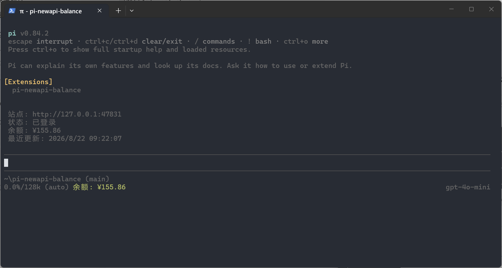
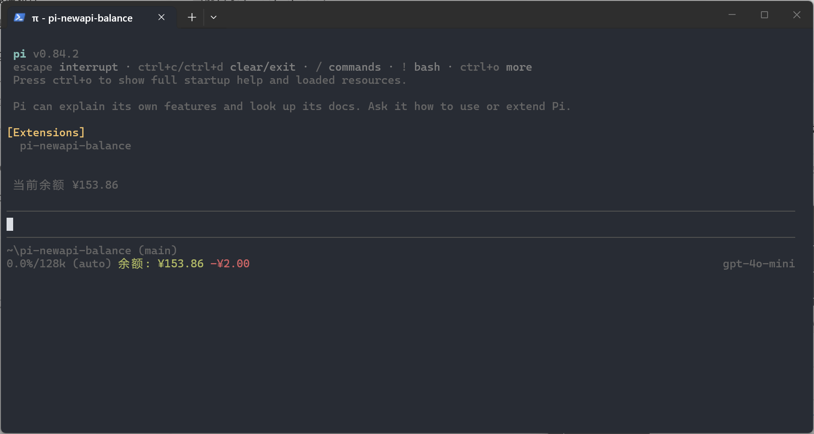

<div align="center">

# Pi New API Balance

[English](README.en.md)

**在 Pi 终端页脚实时显示 New API 余额，扣款瞬间播放余额滚动动画。**

<sub>// 支持任意 New API 站点 · 无需面板 · 不打断 Agent</sub>

<br />


</div>

---

> 以下截图来自隔离的本地 mock 服务，余额、账号状态和时间均为合成演示数据，不对应任何真实账户。

## 截图

<table>
  <tr>
    <td width="50%" align="center">
      
      <sub><b>页脚状态</b> — 余额常驻页脚，不占用额外面板</sub>
    </td>
    <td width="50%" align="center">
      
      <sub><b>扣款动画</b> — 余额滚动下降 + 红色差额显示 3 秒</sub>
    </td>
  </tr>
</table>

## 功能

- ⚙️ **任意站点** — 支持用户配置任意 New API 站点的 Base URL（自动去除末尾 `/v1`）
- 👀 **常驻页脚** — 余额显示在 Pi 页脚，不占用额外面板
- 🔄 **智能刷新** — 启动时 + 每 5 分钟自动刷新；每轮 Agent 完全结束后立即刷新，并在 1/3/6 秒补查异步结算
- 🎬 **扣款动画** — 检测到余额下降立即取消剩余补查，约 800ms 滚动至新值，红色差额显示 3 秒
- 🧹 **安全清理** — Session 切换、`/reload`、新对话、手动刷新和退出时清理后台任务
- 🔑 **自动重登录** — 失效 Session 自动重新登录
- 📦 **配置迁移** — 兼容旧版猫佬余额扩展配置

## 安装

要求已安装支持 Pi Package 的新版 Pi。推荐 npm：

```bash
pi install npm:pi-newapi-balance
```

或直接从 GitHub 安装：

```bash
pi install git:github.com/zxbdzh/pi-newapi-balance
```

重启 Pi，或在已打开的 Pi 中运行 `/reload`。

| 更新 | 卸载 |
| --- | --- |
| `pi update npm:pi-newapi-balance` | `pi remove npm:pi-newapi-balance` |

## 使用

首次运行：

```text
/newapi-login
```

按持续显示的三步提示依次输入网站地址、账号和密码（密码只显示掩码）。

| 命令 | 作用 |
| --- | --- |
| `/newapi-login` | 登录或切换 New API 站点 |
| `/newapi-refresh` | 立即刷新余额 |
| `/newapi-status` | 查看站点、余额、更新时间及错误状态 |
| `/newapi-logout` | 退出并清除本地凭据 |

## 刷新与扣款动画

插件监听 Pi 的 `agent_settled` 事件：每轮 Agent 不会再自动重试、压缩上下文或产生后续动作时才刷新，避免中间态读数。扣款动画详见 [工作原理](docs/)。

## 开发

```bash
npm test     # node --test 单元测试
npm run check
```

## 许可证

[MIT](./LICENSE)
